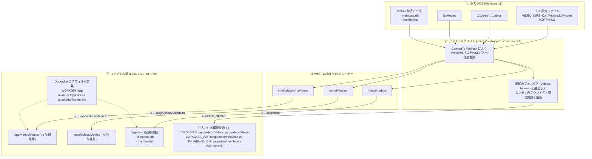

# 本番環境におけるパス・環境変数・コンテナ構成仕様

本書では、TagBasedVideoManager の本番環境における **Dockerfile**、**.env**、**ホストOSのパス**、**WSL3のパス**、**コンテナのパス** の関係性、パス変換ルール、およびマウント仕様を整理します。

---

## 1. 全体像とアーキテクチャ関係図

Windows 11（WSL 3.0 環境）でデプロイスクリプト（`scripts/deploy.ps1`）を実行した際の、パス変換とマウントの流れです。



---

## 2. パス・環境変数の対応関係表

| 項目                     | ① ホストOS (Windows)                            | ② WSL3 (`wslc` 実行時)                | ③ コンテナ内パス         | ④ 注入される環境変数 / Dockerfile                  |
| :----------------------- | :---------------------------------------------- | :------------------------------------ | :----------------------- | :------------------------------------------------- |
| **動画フォルダ 1**       | `C:\Users\...\Videos`                           | `/mnt/c/Users/.../Videos`             | `/app/videos/Videos`     | `-v /mnt/c/.../Videos:/app/videos/Videos:ro`       |
| **動画フォルダ 2**       | `D:\Movies`                                     | `/mnt/d/Movies`                       | `/app/videos/Movies`     | `-v /mnt/d/Movies:/app/videos/Movies:ro`           |
| **動画スキャン対象一覧** | `.env` の `VIDEO_DIRS` にセミコロン区切りで記述 | スクリプト内で各パスを WSL 形式に変換 | 各フォルダが独立マウント | `VIDEO_DIRS=/app/videos/Videos;/app/videos/Movies` |
| **データ永続化ルート**   | `.\data` (プロジェクト直下)                     | `/mnt/<ドライブ>/.../data`            | `/app/data`              | `-v /mnt/.../data:/app/data`                       |
| **SQLite データベース**  | `.\data\metadata.db`                            | `/mnt/.../data/metadata.db`           | `/app/data/metadata.db`  | `DATABASE_PATH=/app/data/metadata.db`              |
| **サムネイル保存先**     | `.\data\thumbnails\`                            | `/mnt/.../data/thumbnails`            | `/app/data/thumbnails`   | `THUMBNAIL_DIR=/app/data/thumbnails`               |
| **Web ポート**           | `http://localhost:5620`                         | ポート 5620 (ホスト共有)              | ポート 5620              | `PORT=5620`（コンテナ実行時 `-p 5620:5620`）       |

---

## 3. 各コンポーネントの役割と詳細仕様

### (1) Dockerfile の役割

- **軽量マルチステージビルド**:
  - ビルドステージ: `mcr.microsoft.com/dotnet/sdk:10.0`
  - ランタイムステージ: `mcr.microsoft.com/dotnet/aspnet:10.0` ＋ `ffmpeg` パッケージ
- **コンテナ内既定ディレクトリ構成**:
  - `WORKDIR /app`（アプリケーションの作業ディレクトリ）
  - `RUN mkdir -p /app/videos /app/data/thumbnails`（マウント先・データ保存用の事前ディレクトリ作成）
- **環境変数の既定値（フォールバック用）**:
  - `ENV PORT=5620`
  - `ENV THUMBNAIL_DIR=/app/data/thumbnails`
  - `ENV DATABASE_PATH=/app/data/metadata.db`
- **ポート公開**:
  - `EXPOSE 5620`

### (2) .env の役割

ホストOS（ユーザー環境）における入力設定インターフェースです。
デプロイスクリプト起動時に読み込まれ、コンテナ起動引数へ変換されます。

```env
PORT=5620
# Web アプリ / コンテナ用の動画ルートフォルダ（セミコロン ';' 区切りで複数指定可能）
VIDEO_DIRS="C:\Users\YourUserName\Videos;D:\Movies"

# データ永続化ディレクトリ（未指定時はリポジトリ直下の ./data が使用されます）
# DATA_DIR=D:\MyData

# 以下は AI File Renamer (デスクトップアプリ) 専用の設定（コンテナ本体は参照しません）
VIDEO_DIR=C:\Users\YourUserName\Videos
```

> [!NOTE]
>
> - `VIDEO_DIRS`（複数形）: Web アプリ本体および Docker コンテナ専用です。
> - `VIDEO_DIR`（単数形）: AI File Renamer（デスクトップコンパニオンアプリ）専用です。

### (3) ホストOS ⇄ WSL3 間のパス解決 (`scripts/common.ps1`)

Windows 11 の WSL 3.0 環境（`wslc.exe`）では、Windows 側のパスをそのままバインドマウントすることはできません。
そのため、`scripts/common.ps1` 内の `ConvertTo-WslPath` 関数により、Windows ドライブレター形式のパスを WSL 形式（`/mnt/...`）へ自動変換します。

- 変換ルール:
  - `C:\Users\foo\Videos` $\rightarrow$ `/mnt/c/Users/foo/Videos`
  - `D:\Movies` $\rightarrow$ `/mnt/d/Movies`
  - バックスラッシュ（`\`）をスラッシュ（`/`）に置換し、末尾スラッシュを正規化。

### (4) WSL3 ⇄ コンテナ内のマウント規則と環境変数注入

コンテナ起動時（`scripts/deploy.ps1` の実行時）に、以下のマッピング引数が生成されます。

1. **ホスト動画フォルダの保護（`:ro` 読み取り専用マウント）**:
   - ホスト側の各物理フォルダを、コンテナ内の `/app/videos/<末尾フォルダ名>` にバインドマウントします。
   - `:ro` フラグを付与することにより、コンテナ（Webアプリ）からの誤削除・ファイル改変を防止します。
   - 例: `-v /mnt/c/Users/foo/Videos:/app/videos/Videos:ro`
2. **コンテナ内 `VIDEO_DIRS` の自動合成**:
   - マウント先のコンテナ内パスをセミコロンで連結し、コンテナ内環境変数に注入します。
   - 例: `-e VIDEO_DIRS="/app/videos/Videos;/app/videos/Movies"`
3. **データ永続化ボリューム（`/app/data` 読み書き可能マウント）**:
   - ホスト側の永続化ディレクトリ（既定: `./data`）をコンテナ内の `/app/data` にマウントします。
   - これにより、コンテナの停止・破棄・イメージ再作成を行っても、以下のデータがホスト側に保持されます。
     - SQLite DB: `/app/data/metadata.db` $\leftrightarrow$ `.\data\metadata.db`
     - サムネイル: `/app/data/thumbnails` $\leftrightarrow$ `.\data\thumbnails`
4. **ハードウェアアクセラレーション（GPU）パススルー**:
   - ホスト上で NVIDIA GPU（`nvidia-smi`）が検出された場合、`--gpus all` を自動付与して CUDA によるサムネイル高速デコードを有効化します。

---

## 4. 設定時の注意事項・制約事項

1. **ドライブ直下の指定禁止**:
   - `VIDEO_DIRS` に `D:\` や `/` などのルートパスを指定することはできません（マウント先となるフォルダ名を自動決定できないため）。必ずサブフォルダを指定してください。
2. **フォルダ名重複の禁止**:
   - 指定する複数フォルダのフォルダ名（Leaf名）が重複している場合（例: `C:\Anime;D:\Anime`）、コンテナ内のマウント先 `/app/videos/Anime` が競合するためエラーとなります。
3. **コンテナ内での `FilePath`**:
   - データベース（SQLite）の `Videos.FilePath` には、コンテナ内パス（例: `/app/videos/Videos/sample.mp4`）が記録されます。
