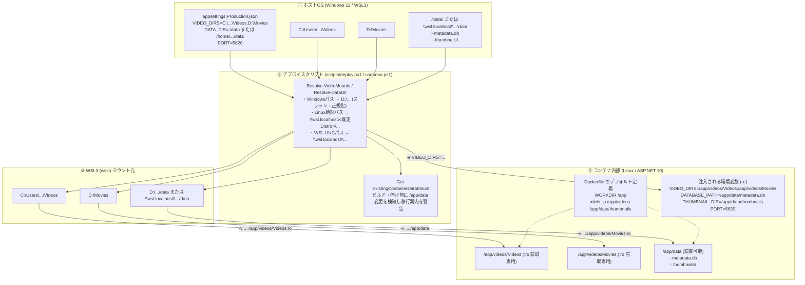

# 本番環境におけるパス・環境変数・コンテナ構成仕様

本書では、TagBasedVideoManager の本番環境における **Dockerfile**、**appsettings.Production.json**（※旧 `.env` は廃止・移行済み）、**ホストOSのパス**、**WSL3のパス**、**コンテナのパス** の関係性、パス変換ルール、およびマウント仕様を整理します。

---

## 1. 全体像とアーキテクチャ関係図

Windows 11（WSL 3.0 環境）でデプロイスクリプト（`scripts/deploy.ps1`）を実行した際の、パス解決とマウントの流れです。



---

## 2. パス・環境変数の対応関係表

| 項目                     | ① ホストOS (Windows / WSL3)                                                                       | ② WSL3 (`wslc` へ渡すホストマウント元)                    | ③ コンテナ内パス         | ④ 注入される環境変数 / Dockerfile                  |
| :----------------------- | :------------------------------------------------------------------------------------------------ | :-------------------------------------------------------- | :----------------------- | :------------------------------------------------- |
| **動画フォルダ 1**       | `C:\Users\...\Videos`                                                                             | `C:/Users/.../Videos`                                     | `/app/videos/Videos`     | `-v C:/Users/.../Videos:/app/videos/Videos:ro`     |
| **動画フォルダ 2**       | `D:\Movies`                                                                                       | `D:/Movies`                                               | `/app/videos/Movies`     | `-v D:/Movies:/app/videos/Movies:ro`               |
| **動画スキャン対象一覧** | `appsettings.Production.json` の `VIDEO_DIRS` にセミコロン区切りで記述（環境変数/引数上書き可）   | Windows パスは `D:/...`、WSL パスは `\\wsl.localhost\...` | 各フォルダが独立マウント | `VIDEO_DIRS=/app/videos/Videos;/app/videos/Movies` |
| **データ永続化ルート**   | `.\data`（既定）または `D:\tbvm\data` / `/home/<user>/tbvm/data` / `\\wsl.localhost\<Distro>\...` | `D:/.../data` または `\\wsl.localhost\<Distro>\...\data`  | `/app/data`              | `-v <MountSource>:/app/data`                       |
| **SQLite データベース**  | `<DATA_DIR>\metadata.db`                                                                          | ホスト永続ディレクトリ配下                                | `/app/data/metadata.db`  | `DATABASE_PATH=/app/data/metadata.db`              |
| **サムネイル保存先**     | `<DATA_DIR>\thumbnails\`                                                                          | ホスト永続ディレクトリ配下                                | `/app/data/thumbnails`   | `THUMBNAIL_DIR=/app/data/thumbnails`               |
| **Web ポート**           | `http://localhost:5620`                                                                           | ポート 5620 (ホスト共有)                                  | ポート 5620              | `PORT=5620`（コンテナ実行時 `-p 5620:5620`）       |

---

## 3. 各コンポーネントの役割と詳細仕様

### (1) Dockerfile の役割

- **軽量マルチステージビルド**:
  - ビルドステージ: `mcr.microsoft.com/dotnet/sdk:10.0`
  - ランタイムステージ: `mcr.microsoft.com/dotnet/aspnet:10.0` ＋ `ffmpeg` パッケージ
- **コンテナ内既定ディレクトリ構成**:
  - `WORKDIR /app`（アプリケーションの作業ディレクトリ）
  - `RUN mkdir -p /app/videos /app/data/thumbnails`（マウント先・データ保存用の事前ディレクトリ作成）
- **環境変数の既定値（フォールバック用）**:
  - `ENV PORT=5620`
  - `ENV THUMBNAIL_DIR=/app/data/thumbnails`
  - `ENV DATABASE_PATH=/app/data/metadata.db`
- **ポート公開**:
  - `EXPOSE 5620`

### (2) appsettings.Production.json の役割

ホストOS（ユーザー環境）における本番設定ファイルです（`src/TagBasedVideoManager/appsettings.Production.json`）。
デプロイスクリプト起動時（`scripts/deploy.ps1` / `scripts/deploy.sh`）に自動読み込みされ、コンテナ起動引数へ変換されます（※従来の `.env` は廃止され、存在しても無視されます）。

```json
{
  "PORT": 5620,
  "VIDEO_DIRS": "C:\\Users\\YourUserName\\Videos;D:\\Movies",
  "THUMBNAIL_DIR": "thumbnails",
  "DATABASE_PATH": "metadata.db",
  "DATA_DIR": "./data"
}
```

> [!NOTE]
>
> - `VIDEO_DIRS`: Web アプリ本体および Docker コンテナ専用の動画フォルダパス一覧（セミコロン `;` 区切り）です。
> - `DATA_DIR`: 永続化データ保存先です（未設定・空文字・空白のみの場合は `./data` にフォールバック）。WSL3 内に永続化する場合は `"/home/<user>/tbvm/data"` または `"\\\\wsl.localhost\\Ubuntu-24.04\\home\\<user>\\tbvm\\data"` を指定できます。
> - 旧 `.env` の `VIDEO_DIR`（単数形）は廃止されました。デプロイスクリプト実行時に旧パラメータのみ残存している場合は、移行案内を表示して安全に終了します。
> - CLI 引数（例: `-VideoDirs "..."`, `-DataDir "..."`, `-Port 5630`）やシェル環境変数（`VIDEO_DIRS`, `DATA_DIR`, `PORT`）が指定された場合は、`appsettings.Production.json` の値より優先されます。

### (3) ホストOS ⇄ WSL3 間のパス解決 (`scripts/common.ps1`)

Windows 11 の WSL 3.0 環境（`wslc.exe`）は、`-v` バインドマウントのホスト側パスとして **Windows スラッシュ区切り絶対パス（`D:/...`）** および **WSL UNC パス（`\\wsl.localhost\<Distro>\<Path>`）** を受け付けます（一方で `/mnt/<drive>/...` を `wslc` へ渡すと Windows 側のカレントドライブ直下に `D:\mnt\...` が誤作成されます）。

`scripts/common.ps1` では役割に応じて以下を分離・解決します:

- **`ConvertTo-ContainerMountPath` / `Resolve-VideoMounts` / `Resolve-DataDir`**:
  - Windows 相対パス・絶対パス（例: `./data`, `D:\My Videos\Clips`）→ リポジトリルート基準の絶対パスへ正規化し、スラッシュ区切り `D:/.../data` へ変換（空白を保持）。
  - WSL UNC パス（`\\wsl.localhost\<Distro>\...`, `\\wsl$\<Distro>\...`, `//wsl.localhost/...`）→ `Resolve-WslUncPath` により `\\wsl.localhost\<Distro>\<subpath>` へ正規化。
  - Linux 絶対パス（例: `/home/user/tbvm/data`）→ `Get-DefaultWslDistro` により `docker-desktop` / `docker-desktop-data` を除外した既定ユーザー WSL ディストロを取得し、`\\wsl.localhost\<Distro>\home\user\tbvm\data` へ自動補完（Windows カレントドライブ直下には作成しない）。
  - WSL 未導入やタイムアウト時（5000ms）は、`wsl --status` / `wsl -l -v` の確認および `\\wsl.localhost\<Distro名>\...` 直接指定の回復手順を案内してビルド前に停止します。
- **`ConvertTo-WslPath`**:
  - Windows / WSL UNC / Linux パスを WSL 内部パス（`/mnt/c/...` や `/home/...`）へ正規化するユーティリティとして提供されます。
- **`scripts/deploy.sh`（Linux 環境）**:
  - `DATA_DIR` の相対パス（例: `./data`）を実行時カレントディレクトリではなく `${REPO_ROOT}` 基準の絶対パスへ正規化します（`python3` 利用、不在時は純粋 Bash フォールバック）。
  - Windows ドライブパス（`D:\...` 等）や `$WSL_DISTRO_NAME` 不一致／未設定時の WSL UNC パスはビルド・停止前に拒否します。

### (4) WSL3 内 `DATA_DIR` 永続化手順

SQLite データベース（`metadata.db`）および生成済みサムネイル（`thumbnails/`）を WSL3 ディストロ内の高速な ext4 ファイルシステム上に永続化する場合は、以下のいずれかを設定します。

1. **Linux 絶対パス指定（推奨・簡潔）**:
   `src/TagBasedVideoManager/appsettings.Production.json` に次のように設定します（Windows 側の既定ユーザー WSL ディストロが自動補完されます）。

   ```json
   {
     "DATA_DIR": "/home/<user>/var/apps/TagBasedVideoManager/data"
   }
   ```

2. **WSL UNC パス明示指定（複数ディストロ運用時に推奨）**:
   特定のディストロを明示したい場合は次のように指定します。

   ```json
   {
     "DATA_DIR": "\\\\wsl.localhost\\Ubuntu-24.04\\home\\<user>\\var\\apps\\TagBasedVideoManager\\data"
   }
   ```

3. デプロイ実行時（`pwsh ./scripts/deploy.ps1`）、ビルド・既存コンテナ停止より前に解決結果サマリ（設定元・生値・WSL ディストロ名・`HostPath`・`MountSource`）が出力され、対象ディレクトリが存在しない場合は自動作成されます。

### (5) 既存 `/mnt/...` や別 `DATA_DIR` からの切り替え時のデータ移行手順・注意点

`scripts/deploy.ps1` および `scripts/deploy.sh` は、イメージビルドや既存コンテナの停止・削除より**前**に `inspect` で既存コンテナ `tag-based-video-manager` の `/app/data` マウント元を確認します。現在設定されている `DATA_DIR` と異なる場合（例: 旧設定の `D:\mnt\e\data` や `./data` から WSL3 内パスへ切り替えた場合、あるいは逆の場合）、スクリプトは以下の 4 要素を含む警告を出力した上でデプロイを続行します（自動コピー・自動削除は行いません）。

1. **旧マウント元パスと新マウント先パス**
2. **旧データは削除されず旧ディレクトリ側に残存している旨**
3. **旧データをそのまま使うための設定復帰例**（`appsettings.Production.json` の `"DATA_DIR"` に旧パスを設定）
4. **新フォルダへ既存データを手動コピーするコマンド例**

#### データ移行手順（旧パス → 新パス）

新コンテナを起動した後に空のデータフォルダが参照されている場合、以下の手順で旧データを移行してください。

- **Windows (PowerShell)**:

  ```powershell
  # 1. コンテナを一旦停止（SQLite DB の整合性確保のため）
  wslc stop tag-based-video-manager

  # 2. 旧 DATA_DIR から新 DATA_DIR へコピー
  Copy-Item -Path "<旧DATA_DIR>\metadata.db" -Destination "<新DATA_DIR>\" -Force
  Copy-Item -Path "<旧DATA_DIR>\thumbnails" -Destination "<新DATA_DIR>\" -Recurse -Force

  # 3. コンテナを再起動
  wslc start tag-based-video-manager
  ```

- **Linux / WSL 内 (Bash)**:

  ```bash
  # 1. コンテナを一旦停止
  docker stop tag-based-video-manager

  # 2. 旧 DATA_DIR の内容を新 DATA_DIR へ属性保持コピー
  cp -a "<旧DATA_DIR>/." "<新DATA_DIR>/"

  # 3. コンテナを再起動
  docker start tag-based-video-manager
  ```

### (6) WSL3 ⇄ コンテナ内のマウント規則と環境変数注入

コンテナ起動時（`scripts/deploy.ps1` / `scripts/deploy.sh` の実行時）に、以下のマッピング引数が生成されます。

1. **ホスト動画フォルダの保護（`:ro` 読み取り専用マウント）**:
   - ホスト側の各物理フォルダを、コンテナ内の `/app/videos/<末尾フォルダ名>` にバインドマウントします。
   - `:ro` フラグを付与することにより、コンテナ（Webアプリ）からの誤削除・ファイル改変を防止します。
   - 例（Windows `wslc`）: `-v C:/Users/foo/Videos:/app/videos/Videos:ro`
2. **コンテナ内 `VIDEO_DIRS` の自動合成**:
   - マウント先のコンテナ内パスをセミコロンで連結し、コンテナ内環境変数に注入します。
   - 例: `-e VIDEO_DIRS="/app/videos/Videos;/app/videos/Movies"`
3. **データ永続化ボリューム（`/app/data` 読み書き可能マウント）**:
   - ホスト側の永続化ディレクトリ（既定: `./data`、または `DATA_DIR` で解決されたパス）をコンテナ内の `/app/data` にマウントします。
   - これにより、コンテナの停止・破棄・イメージ再作成を行っても、以下のデータがホスト側に保持されます。
     - SQLite DB: `/app/data/metadata.db` $\leftrightarrow$ `<DATA_DIR>/metadata.db`
     - サムネイル: `/app/data/thumbnails` $\leftrightarrow$ `<DATA_DIR>/thumbnails`
4. **ハードウェアアクセラレーション（GPU）パススルー**:
   - ホスト上で NVIDIA GPU（`nvidia-smi`）が検出された場合、`--gpus all` を自動付与して CUDA によるサムネイル高速デコードを有効化します。

---

## 4. 設定時の注意事項・制約事項

1. **ドライブ直下・ルート単体・ドライブ相対の指定禁止**:
   - `VIDEO_DIRS` や `DATA_DIR` に `D:\`、`D:`、`D:data`、`/` 単体、`\\wsl.localhost\Ubuntu-24.04`（サブパスなし）を指定することはできません。必ずサブフォルダを指定してください。
2. **パストラバーサルおよび通常ファイル誤指定の禁止**:
   - パスセグメントとしての `..`（例: `../data`, `/home/../etc`）や、ディレクトリではなく既存の通常ファイル（例: `./data/metadata.db`）の指定はビルド前に拒否されます。なお、`v1..v2` のようにディレクトリ名の一部に `..` を含むだけの正当なパスは許可されます。
3. **フォルダ名重複の禁止**:
   - `VIDEO_DIRS` に指定する複数フォルダのフォルダ名（Leaf名）が重複している場合（例: `C:\Anime;D:\Anime`）、コンテナ内のマウント先 `/app/videos/Anime` が競合するためエラーとなります。
4. **コンテナ内での `FilePath`**:
   - データベース（SQLite）の `Videos.FilePath` には、コンテナ内パス（例: `/app/videos/Videos/sample.mp4`）が記録されます。
